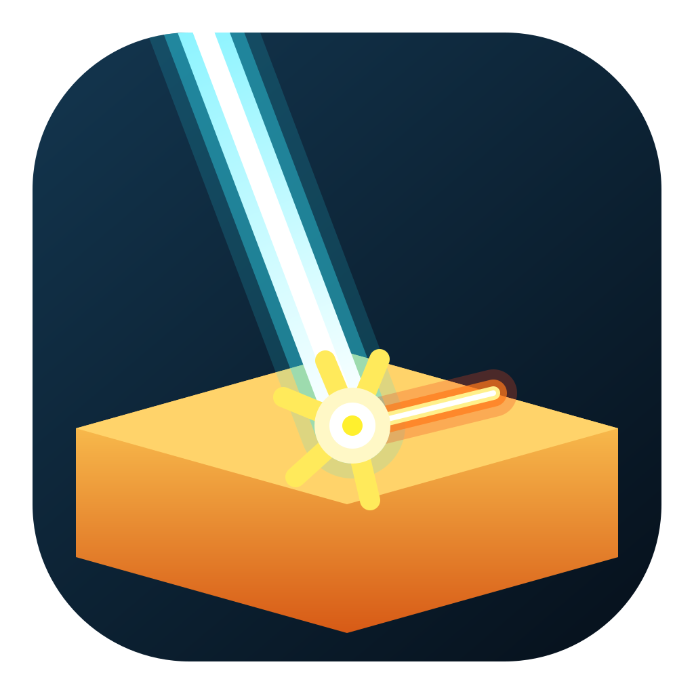

# Beam Forge

A laser cutter editor and controller with a modern UX: Figma-style canvas, command palette, live toolpath preview, and guided workflows. Built for GCode controllers (GRBL first) over USB serial. Windows first.

Status: app scaffold. See the [roadmap](../../issues/32).

## Run

Requires Node 24.11+, npm, stable Rust (1.90+), and the [Tauri prerequisites](https://v2.tauri.app/start/prerequisites/) (on Windows: MSVC C++ build tools and WebView2).

```sh
npm ci
npm run desktop:dev
```

`npm run dev` serves a browser preview at http://127.0.0.1:1420. It is labelled as a preview and has no Rust side, so it can't reach the machine.

`npm run desktop:build` writes installers to `target/release/bundle` (NSIS and MSI). They are unsigned.

## Simulator

`npm run sim:dev` opens **Beam Forge Simulator**, a separate app that emulates a GRBL 1.1 laser (`crates/bf-sim`) and exposes it as a "fake USB" port: a TCP server on `127.0.0.1:23232`. Point Beam Forge (or any GRBL sender that speaks raw TCP) at that address instead of a serial port.

- One client at a time. Connecting resets the controller and sends the banner, like opening an Arduino's USB port; disconnecting is a pulled cable. A second client gets `[MSG:Simulator busy: ...]` and is closed.
- Speed: 1x, 10x, 100x or instant. Settings, presets and Reset machine are in the window; changing settings power-cycles the controller.
- Change the port in the window, or start with `BF_SIM_PORT=23233`.

`npm run sim:build` writes its installers to `target/release/bundle`; `npm run sim:verify` runs its frontend checks. Its Rust tests run with `npm run test:rust`.

## Verify

```sh
npm run verify      # svelte-check, Oxlint, ESLint (Svelte markup + shadcn), formatting, tests, web build
npm run test:rust   # Rust unit and IPC tests; regenerates TS bindings
npm run lint:rust   # rustfmt and clippy with warnings denied
```

CI (`.github/workflows/ci.yml`) runs the Rust checks on Windows and Linux, and these web checks plus `npm run sim:verify` on Linux. On pushes to `main` it also builds both apps' installers, checks that the packaged app closes cleanly from the native close button, and checks that the Linux packages launch the built-in simulator. PRs skip the installers, and docs-only changes skip CI.

## Layout

| Path                | Purpose                                                            |
| ------------------- | ------------------------------------------------------------------ |
| `src/`              | SvelteKit frontend (document, canvas, UI)                          |
| `src/lib/desktop/`  | Platform adapter, app lifecycle, close guard, updater              |
| `src/lib/bindings/` | TypeScript types generated from Rust (`npm run bindings`)          |
| `crates/bf-core/`   | Product logic: geometry, toolpaths, GCode, machine driver          |
| `crates/bf-sim/`    | GRBL 1.1 emulator for tests and the simulator app                  |
| `src-tauri/`        | Tauri shell: commands, plugins, capabilities                       |
| `simulator/`        | Simulator app (npm workspace): bf-sim behind a TCP fake USB link   |
| `scripts/`          | Update service and signing scripts, lint proof, native close probe |

Self-updates: see [docs/desktop-updates.md](docs/desktop-updates.md).

## Stack

Resolved October 2026: SvelteKit 3.1.1, Svelte 5.57.3, Tailwind 4.3.3, shadcn-svelte 1.7.2 (Nova preset), @shadcn/lint 0.2.3, Vite+ 1.4.0, TypeScript 6.0.3 (7.x not yet supported by Kit 3), ESLint 10.14, Tauri 2.12.5 (CLI/API 2.12.4, updater 2.14.1, process 2.4.0), ts-rs 12.0.1, Rust 1.99.1, Node 24.15. Lockfiles: `package-lock.json`, `Cargo.lock`.

## License

MIT. See [LICENSE](LICENSE). The bundled Geist test font is under the SIL Open Font License (`crates/bf-core/src/text/testdata/OFL.txt`).
